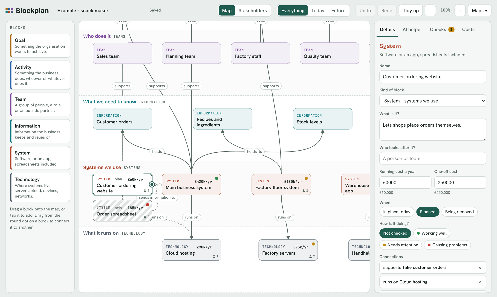
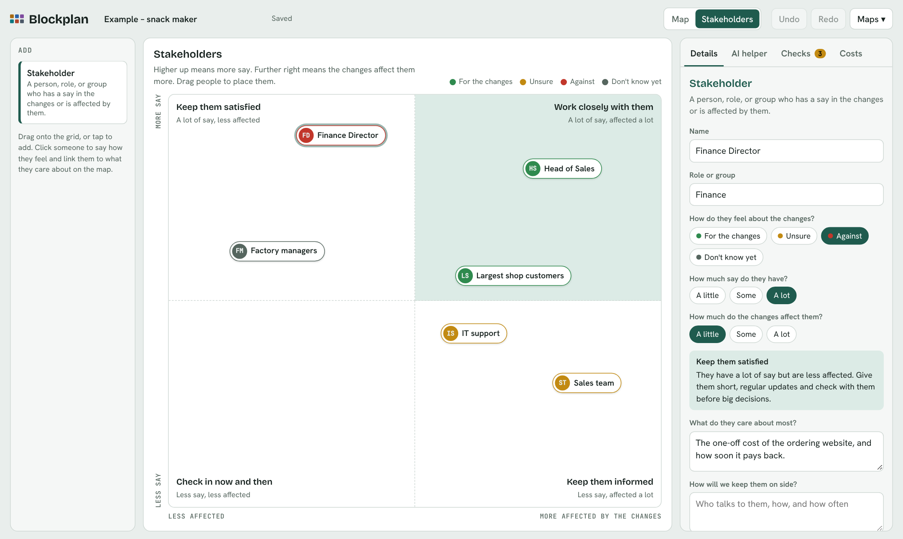

# Blockplan

**Map how your organisation works in an afternoon, in words everyone understands.**

Blockplan is a simple, drag-and-drop way to map an organisation: what it's trying to achieve, what it does, who does it, the information it relies on, the systems it uses, and what those systems run on. It shows what things cost, what's changing, and who cares about the changes. An AI helper you can ask in plain English builds starter maps, explains them, and spots what's missing. It works with Claude, Azure OpenAI, OpenAI, most other AI services, or a model on your own machine.

It's built so that someone new to architecture work can use it on day one, and so that the business people in the room can follow the map without help. There are no framework names, no acronyms, and nothing to learn before you start. Underneath, it maps cleanly to ArchiMate, so the work isn't lost when it moves into a full architecture tool.



## Contents

- [Who it's for](#who-its-for)
- [Why Blockplan](#why-blockplan)
- [What it does](#what-it-does)
- [Quick start](#quick-start)
- [The AI helper](#the-ai-helper)
- [Importing and exporting](#importing-and-exporting)
- [Running it for a team](#running-it-for-a-team)
- [HTTPS](#https)
- [Your maps](#your-maps)
- [The API](#the-api)
- [Settings](#settings)
- [Common questions](#common-questions)
- [What's next](#whats-next)
- [Project layout](#project-layout)
- [Licence](#licence)

## Who it's for

Blockplan is for the first conversation, not a replacement for a full enterprise architecture platform. Experienced architects already have tools for the long-term record. Blockplan is the tool that gets a workshop going in minutes and leaves everyone with something they understand.

- **Architects doing discovery.** A new client, a newly acquired business, a division nobody has mapped, or a business being separated out. Once a deal is signed, you have to assess the business, agree the target state, and plan the transition, usually with people who have never seen an architecture diagram. Blockplan puts the today and future views, the costs and payback, and who's for or against the changes in one place.
- **New and junior architects.** It teaches the shape of the job, from goals and activities through to systems and technology, without the jargon. The checks act like a mentor, pointing out gaps as you build.
- **Organisations without an architecture team.** Small and mid-sized organisations that can't justify a platform licence but need to see their estate, their costs, and their risks.
- **Consultancies.** A free, quick tool for pre-sales and discovery that leaves the client with something useful.

## Why Blockplan

- **Plain words on top, ArchiMate underneath.** The six rows line up with ArchiMate's layers: goals with Motivation; activities, teams, and information with Business; systems with Application; and technology with Technology. A map started in a workshop exports as a valid ArchiMate model, ready for Archi or another architecture tool.
- **Cost and payback next to the architecture.** Most tools treat these separately. Seeing "this change saves £25k a year and pays for itself in about ten years" beside the map is what gets a decision made.
- **Stakeholders on the same page.** Changes more often fail because of people than because of technology. Blockplan records who has a say, who is affected, how they feel, and what they care about, and links them to the parts of the map they care about.
- **It runs on your own server, with the AI you choose.** Use Claude, your organisation's Azure OpenAI, another AI service, or a model on your own machine. For government, defence, finance, or anyone else who needs it, `AI_MODE=local` means nothing about your maps leaves your network. It uses HTTPS from the first run, and a real certificate is a matter of dropping it into a folder.
- **Free and open.** MIT licensed. No procurement, no licence conversation, so people can try it the same day.

## What it does

- **Six plain rows.** Why we do it (goals), What we do (activities), Who does it (teams), What we need to know (information), Systems we use, and What it runs on (technology).
- **Drag and drop.** Drag a block onto the map, or tap it to add one. Drag from the round dot on a block to another block to connect them. The connecting words are filled in for you, and you can change them.
- **Follow a connection.** Click a line and it turns red and is drawn above the boxes, so you can follow it from end to end.
- **Today and future.** Mark anything as in place today, planned, or being removed, then switch between Today and Future to see the map before and after. Planned blocks have a dashed outline. Blocks being removed have grey stripes, with the name crossed through.
- **Health.** Mark each block as working well, needing attention, or causing problems.
- **Costs.** Add a yearly running cost and a one-off cost to any block. The Costs tab totals them, compares today with the future, and works out how long the changes take to pay for themselves.
- **Stakeholders.** Choose **Stakeholders** at the top to see the people and groups who have a say in the changes or are affected by them, on a simple grid: more say towards the top, more affected towards the right. Each corner says how to work with them. Note how each one feels, what they care about, and how you'll keep them on side, and link them to the blocks they care about. Blocks show how many stakeholders care about them.
- **Checks.** Simple rules flag gaps as you build. They include a system nothing uses, an activity no one does, a plan that depends on something being removed, a stakeholder with a lot of say who is against the changes, and a change nobody has been linked to.
- **AI helper.** Build a starter map, explain the map, find what's missing, spot risks, overlaps, and savings, and suggest stakeholders. It always shows its suggested changes first, and you choose whether to put them on the map.
- **Bring in what you already have.** Import a spreadsheet (CSV), such as an application list from a CMDB.
- **Share it.** Download a PDF report, a picture of the map or the stakeholder grid for slides, a spreadsheet, or an ArchiMate model.
- **Shared maps.** Maps are saved on the Blockplan server, so everyone using it sees the same maps. If two people save the same map at once, the second person is told and can load the other version or keep theirs as a copy.



## Quick start

Blockplan runs on Windows, macOS, and Linux. You need Python 3.10 or newer.

On a Mac, the Python that comes with Apple's developer tools is usually 3.9, which is too old. Install a newer one from [python.org](https://www.python.org/downloads/macos/) or with `brew install python`. `run.sh` finds it automatically.

**From GitHub**

```bash
git clone https://github.com/Tony1044/blockplan
cd blockplan
./run.sh
```

On Windows, double-click `run.bat` in the `blockplan` folder instead of running `./run.sh`.

**From the zip file**

Unzip `blockplan.zip`, then run `./run.sh` in the `blockplan` folder on macOS or Linux, or double-click `run.bat` on Windows.

Then open **https://localhost:8080**. Blockplan uses HTTPS from the start, with a self-signed certificate it makes on the first run, so your browser will warn you the first time. Choose **Advanced**, then **Continue** or **Proceed**, to open it. [HTTPS](#https) explains how to stop the warning, use your own certificate, or switch back to plain HTTP.

The first run sets everything up and creates an example map, a snack maker with costs, planned changes, and stakeholders, so you can see how it all fits together.

To switch on the AI helper, open the `.env` file the first run created, add a key for Claude or another AI service (see [The AI helper](#the-ai-helper)), and restart Blockplan.

## The AI helper

Blockplan works with any of these. Set up one or more in `.env`:

| Service | What to set | Notes |
|---|---|---|
| **Claude** | `ANTHROPIC_API_KEY` | Get a key at https://platform.claude.com/settings/keys. `CLAUDE_MODEL` defaults to `claude-sonnet-5-5`. `claude-haiku-5-5` is quicker and cheaper, and `claude-opus-5-5` is the most capable for large maps. Create the key for a single workspace; if it works across several, also set `ANTHROPIC_WORKSPACE_ID`. |
| **Azure OpenAI** | `AZURE_OPENAI_ENDPOINT`, `AZURE_OPENAI_API_KEY`, `AZURE_OPENAI_DEPLOYMENT` | For organisations on Microsoft, including through Azure AI Foundry. The endpoint looks like `https://your-resource.openai.azure.com`, and the deployment is the name you gave the model in Azure. |
| **OpenAI, and services that work the same way** | `OPENAI_BASE_URL`, `OPENAI_API_KEY`, `OPENAI_MODEL` | Works with OpenAI and with any service that accepts OpenAI-style requests. See the addresses below. |
| **A model on this machine** | `OLLAMA_MODEL` | Install [Ollama](https://ollama.com), then run `ollama pull qwen2.5:7b`. Larger models such as `qwen2.5:14b` give better answers if the machine has the memory. |

Addresses for `OPENAI_BASE_URL`:

| Service | `OPENAI_BASE_URL` |
|---|---|
| OpenAI | `https://api.openai.com/v1` (the default) |
| OpenRouter, for hundreds of models with one key | `https://openrouter.ai/api/v1` |
| Mistral | `https://api.mistral.ai/v1` |
| Google Gemini | `https://generativelanguage.googleapis.com/v1beta/openai` |
| Groq | `https://api.groq.com/openai/v1` |
| LM Studio, vLLM, or another AI server on your own machine | for example `http://localhost:1234/v1`, with no key needed |

`OPENAI_MODEL` is any chat model the service offers, for example `gpt-5.5` on OpenAI. `OPENAI_NAME` sets the name the page shows for it.

**What about Copilot?** Microsoft 365 Copilot has a Chat API, but it's still in preview. It also needs each person to sign in with their own Microsoft 365 Copilot licence, and by default it mixes in results from your Microsoft 365 data and the web. Blockplan doesn't connect to it yet. For now, organisations on Microsoft can use the same family of models through Azure OpenAI.

**Choosing between them.** `AI_MODE` decides which is used:

| AI_MODE | What happens |
|---|---|
| `auto` | Tries each service that's set up, in the order in `AI_ORDER` (Claude, then Azure OpenAI, then OpenAI, then the local model). If one doesn't answer, the next is tried. This is the default. |
| `claude`, `azure`, `openai`, or `local` | Uses only that one. |
| `off` | No AI helper. Everything else still works. |

The AI helper tab shows which service will answer, and which is next if it doesn't.

When the helper is used, the map's names, descriptions, owners, statuses, costs, and stakeholders are sent with the question to the service that answers. Use `AI_MODE=local` if that information must stay on your network. A local model is slower and less reliable on big requests, so ask for one part of the map at a time. The helper is told to name stakeholders by role, such as "Head of Finance", and never to invent personal names.

## Importing and exporting

Everything is in the **Maps** menu.

### Import from a spreadsheet

Save the spreadsheet as CSV, with one row per item and column names in the first row. Commas, semicolons, and tabs all work. Blockplan recognises common column names:

| Blockplan field | Column names it recognises |
|---|---|
| Name | Name, Application, System, Title, Service |
| Kind of block | Type, Kind, Category, Layer. Values such as Application, Capability, Team, Data, Infrastructure, or Goal pick the row. |
| Description | Description, Notes, Purpose, Summary |
| Who looks after it | Any column with "owner" in its name, Responsible, Accountable |
| Status | Status, Lifecycle, Stage, Phase. Planned, Proposed, or Pipeline means planned. Retire, Sunset, Decommission, or To be replaced means being removed. |
| Health | Health, RAG, Condition, Technical fit. Green, Amber, and Red work, as do Good, Fair, and Poor. |
| Yearly cost | Any column with "cost", "annual", or "opex" in its name. Amounts like 40k and £1.2m both work. |
| One-off cost | One-off, Setup, Capex, Project cost, Implementation |

You see a preview first and can change any match before importing. Rows without a kind go into the row you choose, Systems by default. You can import into the current map or a new one. Importing into an existing map updates blocks with the same name instead of adding them twice.

**Download as a spreadsheet** gives a CSV in the same layout, so it doubles as a template.

### PDF report

A landscape A4 report, ready to send or print. [See an example](docs/example-report.pdf). It contains:

1. A summary with counts, yearly costs today and in future, payback, what's planned and being removed, and how stakeholders feel
2. The map, split across pages if it's wide
3. The stakeholder grid
4. Stakeholders in detail, with how to work with each one
5. Costs by row, and the biggest costs
6. Things to look at, from the checks
7. Everything on the map, grouped by row

### Picture

A PNG of whatever you're looking at: the map (Everything, Today, or Future) or the stakeholder grid. It always uses the light colours, so it suits slides. When a connection's label has no clear space on the picture, it's listed under the map instead.

### ArchiMate

A model in the Open Group ArchiMate exchange format (version 3.1). In Archi, use **File → Import → Open Exchange XML Model**. Other tools that support the exchange format can import it too.

| Blockplan | ArchiMate |
|---|---|
| Goal | Goal |
| Activity | Business Function |
| Team | Business Actor |
| Information | Business Object |
| System | Application Component |
| Technology | Node |
| Stakeholder | Stakeholder |

Connections become the matching ArchiMate relationship:

| Blockplan connection | ArchiMate relationship |
|---|---|
| Activity *helps achieve* goal | Realization |
| Team *does* activity | Assignment |
| System *supports* activity | Serving |
| System *holds* information | Access |
| System *sends information to* system | Flow |
| System *runs on* technology | Serving, from the technology to the system |
| Activity *leads to* activity | Triggering |
| Information *is part of* information | Aggregation |
| Stakeholder *cares about* anything | Association |

Where ArchiMate wouldn't allow the matching relationship between two elements, the connection becomes an Association, so every relationship in the model is valid. Exports are checked against the Open Group schema and against Archi's own rules for which relationships are allowed.

Owner, status, health, and costs come across as properties, and descriptions as documentation. Stakeholders bring their role, feeling, say, how much they're affected, what they care about, and the plan. The model includes three views: the map, with a group for each row; the stakeholder grid; and what stakeholders care about.

## Running it for a team

**Linux server, starting on boot**

```bash
cd blockplan
bash deploy/setup.sh
```

This installs Blockplan as a service. Edit `.env`, then run `systemctl --user restart blockplan`.

**Docker**

```bash
cd blockplan
cp .env.example .env      # then add your API key
docker compose up -d
```

Then open **https://localhost**. With Docker, Blockplan uses the standard HTTPS port, 443, so there's no port number in the address. If something else on the computer already uses 443, such as IIS or another web server, set a different port in `.env` and run `docker compose up -d` again:

```
BLOCKPLAN_PORT=8443
```

The address is then `https://localhost:8443`. Inside the container Blockplan always uses 8080, so `BLOCKPLAN_PORT` is the only setting to change. Blockplan's start-up message, shown by `docker compose logs blockplan`, gives the address to use.

Maps are kept in `./data` and certificates in `./certs`. If Ollama runs on the host, the container reaches it automatically.

To update, get the new files (`git pull`, or unzip the new version over the old one), then rebuild:

```bash
docker compose up -d --build
```

Your maps, `.env`, and certificates are kept. From version 1.3.2, Docker serves Blockplan at `https://localhost` on port 443, unless `BLOCKPLAN_PORT` in your `.env` says otherwise; before that it was `http://localhost:8080`. When you update without Docker, `run.sh` and `run.bat` install anything new the next time they start.

```powershell
$env:COMPOSE_BAKE = "false"     # PowerShell; in bash use: export COMPOSE_BAKE=false
docker compose up -d --build
```

**Sign-in.** Set `AUTH_USER` and `AUTH_PASSWORD` in `.env` to ask everyone for a username and password. This is a simple shared login, so switch on [HTTPS](#https) as well, so the password isn't sent in plain text. If Blockplan is reachable from outside your network, also consider a VPN or Tailscale.

## HTTPS

Blockplan uses HTTPS from the first run. If there's no certificate in the `certs` folder, it makes a self-signed one there, covering `localhost` and this computer's name, and keeps using it until it's about to expire. Open `https://localhost:8080`, or `https://localhost` with Docker, not `http://`.

When it starts, Blockplan says which certificate it's using, which names it covers, and when it expires. It warns you when there are 30 days or less left. If something's wrong, such as a key that doesn't match the certificate or a wrong password, it stops with a plain explanation instead of starting half-working.

### The browser warning

A self-signed certificate isn't vouched for by anyone your browser knows, so it warns you. You can choose **Advanced**, then **Continue** or **Proceed**, each time. To stop the warning on a computer, trust the certificate there:

- **Windows:** copy `certs/self-signed-cert.pem` to the computer and rename it to `blockplan.crt`. Double-click it, choose **Install Certificate**, then **Local Machine**, then **Place all certificates in the following store**, and choose **Trusted Root Certification Authorities**. Restart the browser.
- **macOS:** double-click `self-signed-cert.pem` to add it to Keychain Access. Open it in Keychain Access, expand **Trust**, and set **When using this certificate** to **Always Trust**. Restart the browser.

If people reach Blockplan by another name or address, such as `blockplan.local` or `192.168.1.20`, add those to `HTTPS_HOSTNAMES`. Then delete the two `self-signed-` files in `certs` and restart, so a new certificate is made that includes them.

### Using your own certificate

For anything beyond testing, use a certificate from your IT team or a provider such as Let's Encrypt. Put it in the `certs` folder and restart Blockplan. It's used instead of the self-signed one. Any one of these works:

- `cert.pem` and `key.pem`
- `fullchain.pem` and `privkey.pem`, as Let's Encrypt makes them
- a `.crt` (or `.cer`) file and a `.key` file with the same name
- one `.pfx` or `.p12` file, as Windows and many IT teams export them, with its password in `TLS_PFX_PASSWORD`

The certificate should include any intermediate certificates from your provider. If the key has a password, put it in `TLS_KEY_PASSWORD`. If your files are elsewhere, point `TLS_CERT` and `TLS_KEY` (or `TLS_PFX`) at them.

### Choosing how HTTPS works

| HTTPS | What happens |
|---|---|
| `self-signed` | Uses a certificate from the `certs` folder, or makes a self-signed one. This is the default. |
| `auto` | HTTPS if there's a certificate in the `certs` folder, otherwise plain HTTP |
| `on` | HTTPS, and Blockplan won't start without a certificate in the `certs` folder |
| `off` | Plain HTTP, at `http://localhost:8080`. With Docker, also set `BLOCKPLAN_PORT=8080`, since 443 is meant for HTTPS. |

With Docker, the `certs` folder next to `docker-compose.yml` is used, so the self-signed certificate is kept there and survives rebuilds. Files in `certs` are never added to Git.

### Using port 443

443 is the standard HTTPS port, so on it the address needs no port number.

- **Docker** uses 443 by default. Change it with `BLOCKPLAN_PORT` in `.env`. See [Running it for a team](#running-it-for-a-team).
- **Windows and macOS without Docker:** set `PORT=443` in `.env` and restart. Windows may ask you to allow it through the firewall.
- **Linux without Docker:** ordinary programs can't use ports below 1024, so leave Blockplan on 8080 and forward 443 to it, with `sudo iptables -t nat -A PREROUTING -p tcp --dport 443 -j REDIRECT --to-port 8080`, or put a reverse proxy such as Caddy or nginx in front of it. The forwarding applies to connections from other computers, so on the server itself keep using port 8080.

## Your maps

- Everything is in one file, `data/blockplan.db`.
- `bash scripts/backup.sh` makes a dated copy in `backups/`, and is safe to run while Blockplan is running.
- **Maps → Download this map as a file** gives a `.blockplan.json` file. **Maps → Open a map file** brings one back in, on this or another copy of Blockplan.

## The API

The page talks to the server through a small JSON API, so anything you can do in the browser can also be done from a script. It isn't versioned yet, so expect it to change.

| Request | What it does |
|---|---|
| `GET /api/status` | Version, and which AI model is available |
| `GET /api/maps` | Lists all maps, with id, name, number of blocks, and when each was last saved |
| `GET /api/maps/{id}` | Gets one map, with its current revision number |
| `POST /api/maps` | Creates a map. The body is `{"map": {...}}`, and the reply includes its new id. |
| `PUT /api/maps/{id}` | Saves a map. The body is `{"map": {...}, "rev": n}`. |
| `DELETE /api/maps/{id}` | Deletes a map |
| `POST /api/ai` | Asks the AI helper. The body is `{"map": {...}, "request": "..."}`, and the reply has its answer plus any suggested changes. Nothing is changed for you. |
| `GET /healthz` | A simple check that Blockplan is running |

A map is the same JSON as a downloaded `.blockplan.json` file: `name`, `currency`, `blocks`, `links`, and `stakeholders`.

- **Saving uses revision numbers.** A save must send the `rev` it read, and is refused with `409` if someone else has saved since. Read, change, then save with the `rev` you got.
- **The server tidies what it's sent.** Unknown block types, connections to missing blocks, and unknown fields are dropped, so a bad request can't break a map.
- **Sign-in** applies to the API too. With `AUTH_USER` and `AUTH_PASSWORD` set, send them with every request, for example `curl -k -u name:password https://localhost:8080/api/maps`. The `-k` tells curl to accept the self-signed certificate; leave it out once you use a real one.

## Settings

All settings live in `.env`. See `.env.example` for the full list with notes. The main ones are:

| Setting | Default | Notes |
|---|---|---|
| `PORT` | `8080` | The port Blockplan listens on. In Docker this stays 8080 inside the container. |
| `BLOCKPLAN_PORT` | `443` | Docker only: the port people use to reach Blockplan |
| `HOST` | `0.0.0.0` | Use `127.0.0.1` to allow this computer only |
| `DATA_DIR` | `./data` | Where maps are stored |
| `AUTH_USER`, `AUTH_PASSWORD` | empty | Set both to require sign-in |
| `AI_MODE`, `AI_ORDER` | `auto`, `claude,azure,openai,local` | Which AI service to use, and the order to try them in |
| `ANTHROPIC_API_KEY`, `CLAUDE_MODEL` | empty, `claude-sonnet-5-5` | Claude |
| `ANTHROPIC_WORKSPACE_ID` | empty | Only for Claude keys that work across several workspaces |
| `AZURE_OPENAI_ENDPOINT`, `AZURE_OPENAI_API_KEY`, `AZURE_OPENAI_DEPLOYMENT` | empty | Azure OpenAI |
| `OPENAI_BASE_URL`, `OPENAI_API_KEY`, `OPENAI_MODEL`, `OPENAI_NAME` | OpenAI's address, then empty | OpenAI or any OpenAI-style service |
| `OLLAMA_URL`, `OLLAMA_MODEL` | `http://localhost:11434`, `qwen2.5:7b` | A model on this machine |
| `HTTPS` | `self-signed` | `self-signed`, `auto`, `on`, or `off` |
| `TLS_CERT`, `TLS_KEY`, `TLS_KEY_PASSWORD`, `TLS_PFX`, `TLS_PFX_PASSWORD` | empty | Only if the certificate isn't in `certs`, or has a password |
| `HTTPS_HOSTNAMES` | empty | Extra names for a self-signed certificate |

## Common questions

**Isn't it too simple for a real estate?**
For a full, long-term record of a large estate, yes, and it isn't trying to be that. It's for the first 80% of a discovery, and for the people who would never open a full architecture platform. When the work needs to move on, export it to ArchiMate and carry on in your main tool.

**Where does my data go?**
Wherever you run Blockplan. Maps are stored in one file on your own server. The only thing that leaves it is what the AI helper sends to Claude when you ask it something, and with `AI_MODE=local` or `AI_MODE=off` nothing leaves at all.

**Can I get my data out?**
Yes, in several ways: as an ArchiMate model, a spreadsheet, a PDF, a picture, the map's own JSON file, or through the API.

**Do I need to know ArchiMate or TOGAF?**
No. Blockplan uses plain words throughout. The ArchiMate export is there for when someone who does know it needs the model.

**Does it work with OpenAI, Copilot, or our own AI?**
It works with Claude, Azure OpenAI, OpenAI, most other AI services that accept OpenAI-style requests, and models on your own machine. Microsoft 365 Copilot's own API is still in preview and needs every user to sign in with a Copilot licence, so Blockplan doesn't connect to it yet; Azure OpenAI gives organisations on Microsoft the same family of models. See [The AI helper](#the-ai-helper).

**Does it work without the internet?**
Yes. The fonts and the PDF maker are included, so everything works offline except the AI helper when it uses an online service. With a model on your own machine, that works offline too.

## What's next

- A documented, versioned API with its own keys, and requests for changing single blocks and stakeholders
- Importing ArchiMate models, as well as exporting them
- Signing in to Microsoft 365 Copilot's Chat API, once it's out of preview
- A hosted demo with the example map loaded, so people can try Blockplan without installing it

## Version history

**1.3.2**
- Docker serves Blockplan on 443, the standard HTTPS port, so the address is `https://localhost`. Change it with `BLOCKPLAN_PORT` in `.env`, with no need to edit `docker-compose.yml`.
- The start-up message gives the address people actually use, including in Docker.

**1.3.1**
- HTTPS from the first run, with a self-signed certificate Blockplan makes and keeps in the `certs` folder. A real certificate in the folder is used instead.

**1.3.0**
- HTTPS: drop a certificate into the `certs` folder, as `.pem` files, `.crt` and `.key` files, or a Windows `.pfx`. Blockplan checks it at start-up and explains any problem.
- More AI services: Azure OpenAI, and OpenAI or any service that accepts OpenAI-style requests, such as OpenRouter, Mistral, Google Gemini, Groq, and LM Studio. Set up several, and Blockplan tries them in order. The AI helper tab shows which will answer.
- Microsoft 365 Copilot's Chat API isn't connected yet. It's still in preview, needs each person to sign in with their own Copilot licence, and by default mixes in results from your Microsoft 365 data and the web.
- `run.sh` and `run.bat` install new requirements after an update.

**Updates to 1.2.0**
- macOS: `run.sh` finds Python 3.10 or newer, since the Python that comes with Apple's developer tools is usually 3.9, and explains how to install a newer one if there isn't one.
- Connections whose labels don't fit in a downloaded picture are listed under the map.

**1.2.0**
- Import from a spreadsheet. Export a PDF report, a picture, a spreadsheet, or an ArchiMate model.
- The selected connection turns red and is drawn above the boxes.
- Things being removed have grey stripes.

**1.1.0**
- Stakeholders, with a grid of say against how affected they are, linked to the map.

**1.0.0**
- The map, costs, checks, shared maps, and the AI helper.

## Project layout

```
app/main.py          web server: the page, saving maps, the AI helper, sign-in
app/storage.py       maps in SQLite, with a check that stops people overwriting each other
app/llm.py           the AI services: Claude, Azure OpenAI, OpenAI-style services, and Ollama
app/tls.py           HTTPS: finds and checks certificates, or makes a self-signed one
app/prompts.py       what the AI helper is told, kept in one place
app/config.py        reads .env
app/static/          the page itself, its fonts, and the PDF maker
docs/                screenshots and an example PDF report
certs/               put a certificate here to switch on HTTPS
deploy/              Linux service setup
scripts/backup.sh    copies all maps to backups/
run.sh, run.bat      start it on macOS, Linux, or Windows
Dockerfile, docker-compose.yml
```

## Licence

Blockplan is MIT licensed. See `LICENSE`.

Bricolage Grotesque, Hanken Grotesk, and JetBrains Mono are included under the SIL Open Font Licence, with their licence files in `app/static/fonts/`. jsPDF and jsPDF-AutoTable are included under the MIT licence, with their licence files in `app/static/vendor/`.
